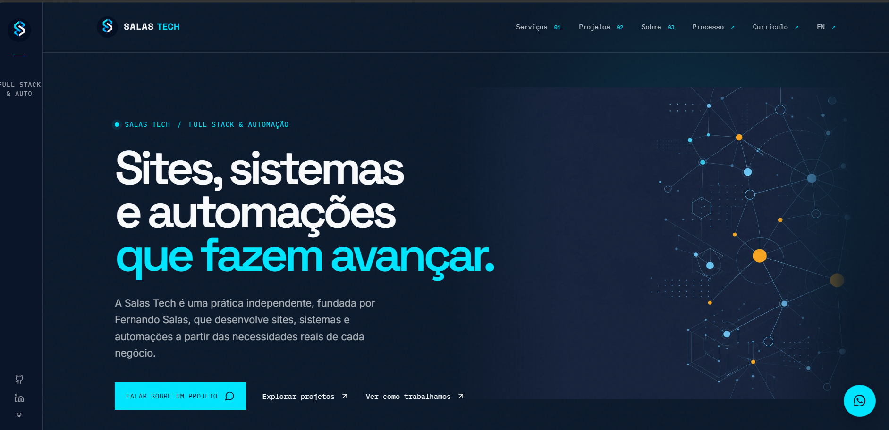

<p align="center">
  
</p>

# Salas Tech - Site Institucional 🚀

[](https://salas-tech-v1.vercel.app)
[]()
[]()
[]()

Repositório oficial do site institucional e portfólio da **Salas Tech**. Desenvolvido para apresentar soluções em tecnologia, destacar projetos concluídos e facilitar o contato com clientes.

🔗 **Acesse o site ao vivo:** [https://salas-tech-v1.vercel.app](https://salas-tech-v1.vercel.app)

---

## 📸 Prévia do Projeto



---

## 🛠️ Tecnologias Utilizadas

Este projeto foi construído utilizando as seguintes tecnologias e ecossistema:

* **Frontend:** React.js com TypeScript e Vite
* **Backend/Shared:** Node.js integrado no ambiente do projeto
* **Estilização:** CSS Customizado (`index.css`, `motion.css`)
* **Gerenciador de Pacotes:** PNPM (arquitetura Monorepo)
* **Hospedagem/Deploy:** Vercel

---

## 📁 Estrutura do Projeto

A arquitetura do projeto utiliza *Workspaces* do PNPM para separar as responsabilidades em um monorepo. A estrutura principal está organizada da seguinte forma:

```text
/
├── client/               # Aplicação Frontend (React + Vite)
│   ├── public/           # Assets públicos (imagens, print da tela, SVGs, manifest)
│   └── src/              # Código-fonte do frontend
│       ├── assets/       # Arquivos de mídia internos
│       ├── components/   # Componentes reutilizáveis da interface
│       ├── contexts/     # Contextos globais (React Context API)
│       ├── hooks/        # Custom hooks do React
│       ├── lib/          # Bibliotecas ou funções utilitárias
│       └── pages/        # Telas/Páginas da aplicação principal
├── server/               # Aplicação Backend/API
├── shared/               # Tipagens e funções compartilhadas entre client e server
├── docs/                 # Documentos do projeto (Brand e PRD)
├── dist/                 # Build de produção gerado
├── pnpm-workspace.yaml   # Configuração das pastas do Monorepo
├── vite.config.ts        # Configuração do bundler Vite
└── vercel.json           # Configuração de deploy da Vercel
```

---

## 💻 Como rodar o projeto localmente

Siga as instruções abaixo para configurar e rodar o projeto no seu ambiente local.

### Pré-requisitos
* **Node.js** instalado (siga a versão indicada no arquivo `.nvmrc`).
* **PNPM** instalado globalmente (`npm install -g pnpm`).

O aplicativo estará disponível no seu navegador, geralmente no endereço: `http://localhost:5173`.

---

## 👨‍💻 Autor

**Fernando Salas Ferreira**  
*Desenvolvedor Full-Stack e Fundador da Salas Tech*

* 🌐 [Site Oficial](https://salas-tech-v1.vercel.app)
* 💼 [LinkedIn](https://linkedin.com/in/salas-fernando)
* 🐱 [GitHub](https://github.com/Salasfernando)

---

<p align="center">Desenvolvido com 💻 e ☕ por Salas Tech.</p>